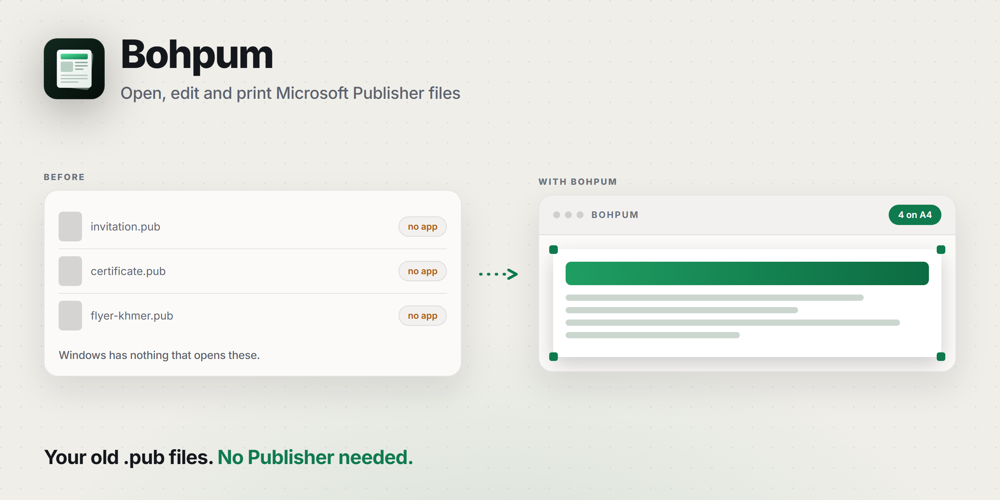
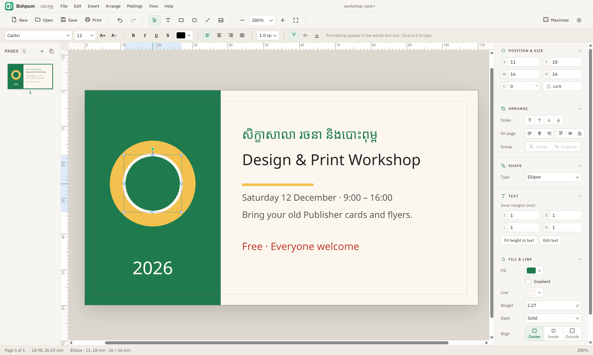
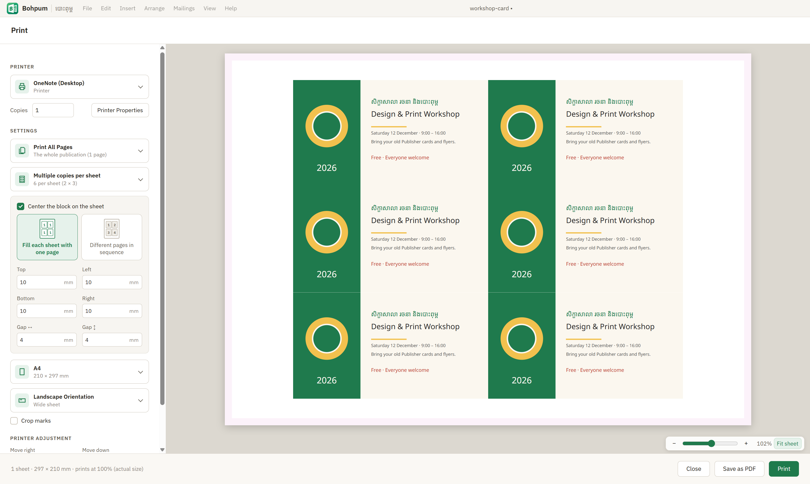

<div align="center">


# Bohpum <sub>បោះពុម្ព</sub>

**Open, edit and print Microsoft Publisher files on Windows. You don't need Publisher.**

<a href="https://apps.microsoft.com/detail/9MWKGK7SCMJS?mode=direct">
  
</a>

[](LICENSE)

[](https://github.com/smith89k/Bohpum/releases)

</div>

<picture>
  <source media="(prefers-color-scheme: dark)" srcset="art/banner-dark.png">
  
</picture>

<p align="center">
  
</p>

## About

Bohpum ("to print" in Khmer) is a desktop publishing app for Windows. It opens your old Microsoft Publisher
(`.pub`) cards, flyers and certificates. You can change the text, pictures and shapes, then print them the way
Publisher does, including several cards on one A4 sheet. It handles Khmer and English text side by side.

Your files stay on your computer. Bohpum has no account, no ads and no tracking.

## Features

- **Opens Publisher files.** Reads `.pub` files from Publisher 98 to 2019 and later, with their text, pictures,
  shapes and tables. Your original file is never changed.
- **Full editor.** Work with text boxes, shapes, lines, pictures and tables. You get colours and gradients,
  master pages, guides, snapping, grouping, alignment, and undo / redo.
- **Khmer first.** Every installed font is listed, with Khmer fonts at the top, each name shown in its own lettering.
- **Picture tools.** Crop, brightness, contrast, recolour, rotate and flip.
- **Publisher-style printing.** Put one card anywhere on the paper, or fill a sheet with copies. A live preview
  shows the result, and you can add crop marks and adjust for your printer. You can also save as PDF or PNG.
- **Mail merge.** Make one card or certificate for each person in an Excel or CSV list, photos included.
- **File Explorer menu.** Right-click `.pub` files and choose **Convert to Bohpum** to convert many at once.
- **Light and dark themes.** It follows Windows, or you can pick one.

<p align="center">
  
</p>

## Install

Get Bohpum from the **[Microsoft Store](https://apps.microsoft.com/detail/9MWKGK7SCMJS?mode=direct)**.
It is signed by Microsoft and updates itself. It runs on Windows 10 (version 2004 or newer) and Windows 11.

## Privacy

Bohpum does not collect, store or send any personal information. Your publications and pictures never leave
your computer. The only time it goes online is to ask the Microsoft Store whether a newer version is available.

## Build from source

You need [Node.js](https://nodejs.org/) (LTS) and [pnpm](https://pnpm.io/).

```sh
git clone https://github.com/smith89k/Bohpum.git
cd Bohpum
pnpm install
pnpm start
```

To open `.pub` files in a development copy, you also need LibreOffice installed on the PC. See the
[developer guide](docs/DEVELOPMENT.md) for testing, building packages, the release process and the project layout.

## Feedback

Found a bug or have an idea? [Open an issue](https://github.com/smith89k/Bohpum/issues).

## Credits

- [LibreOffice](https://www.libreoffice.org/) reads Publisher files in the background (MPL 2.0).
- Interface fonts: [IBM Plex Sans and IBM Plex Mono](https://github.com/IBM/plex), and
  [Noto Sans Khmer](https://fonts.google.com/noto/specimen/Noto+Sans+Khmer) (SIL Open Font License 1.1).
- Built with [Electron](https://www.electronjs.org/).

## License

Bohpum is released under the [MIT License](LICENSE). © 2026 Taing Sunnguon.

*Microsoft Publisher is a trademark of Microsoft Corporation. Bohpum is not affiliated with or endorsed by Microsoft.*
